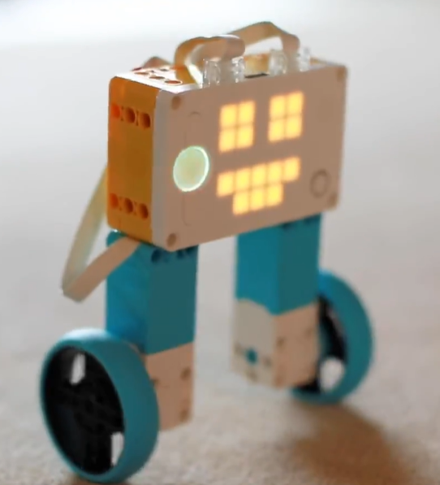
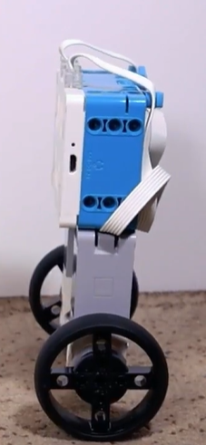
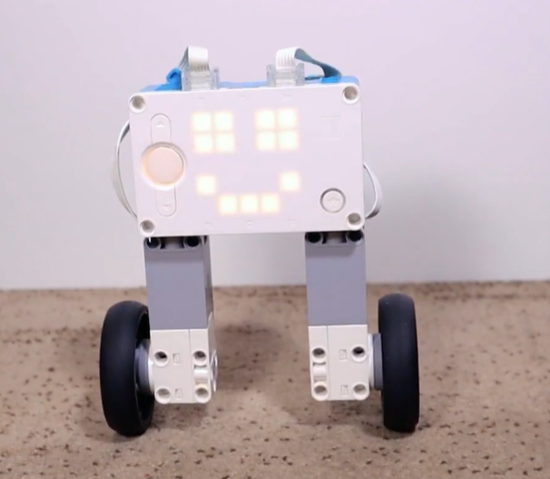
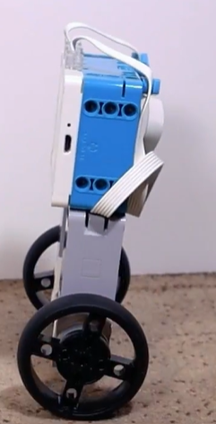
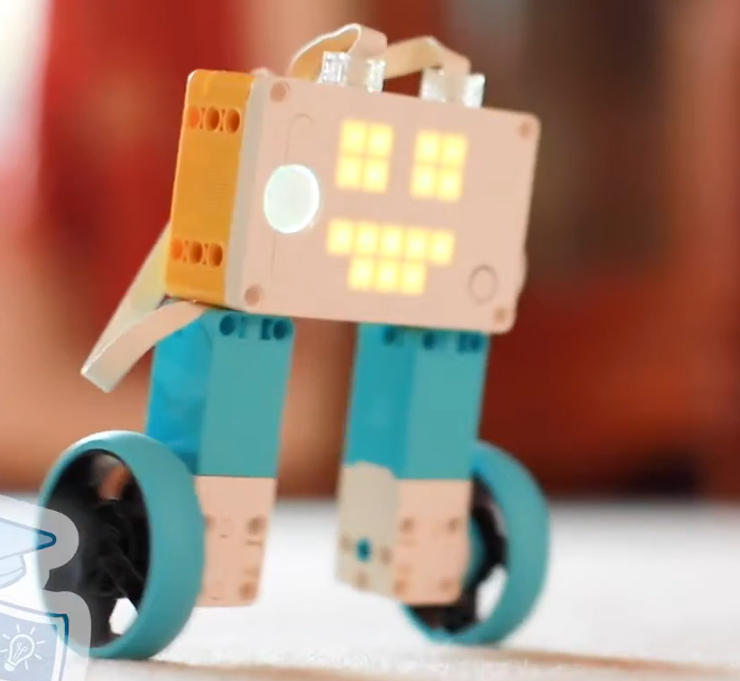

# Balancing Bot Bob

A two-wheeled self-balancing LEGO robot controlled with a **PID balancing program in Python**.

Bob stands upright on two wheels (an inverted pendulum) and uses the hub’s motion sensors plus motor feedback to stay balanced and drive around.

<p align="center">
  
  
</p>

<p align="center">
  
  
</p>

<p align="center">
  
</p>

## Hardware

- LEGO MINDSTORMS Robot Inventor / SPIKE Prime style hub
- Two drive motors on ports **B** and **F**
- Large wheels at the base so the hub stands vertically
- Built-in accelerometer / gyro for pitch sensing

## How the PID balance works

The main loop in [`balancing bot bob.py`](balancing%20bot%20bob.py) runs continuously once Bob is nearly upright.

1. **Pitch estimate** — blends gyro rate with accelerometer angle so the robot knows how far it is leaning.
2. **Speed PID** — if Bob is moving too fast or too slow compared to the target speed, the controller adjusts the *target lean* (pitch setpoint).
3. **Pitch PID** — drives motor power to correct lean and keep Bob upright.
4. **Yaw PID** — keeps left/right wheel balance so Bob holds a heading while turning.

If Bob tips past about 45°, motors cut out and the PIDs reset until he is stood up again (within ~3°).

## Controls & demos

After balancing starts, the hub left/right buttons cycle through demo presets:

| Preset | What it does |
|--------|----------------|
| Face | Just balance and show a face |
| Line | Drive forward / backward |
| J-turn | Drive, reverse, and turn together |
| Perimeter | Drive then turn 90° (patrol loop) |
| Round | Drive while spinning in a circle |
| Spin | Spin in place |

## Running the program

1. Build Bob with motors on ports **B** and **F**.
2. Open `balancing bot bob.py` in the LEGO Python environment for your hub.
3. Run the program, stand Bob upright, and wait for the face to appear when balancing engages.
4. Use the hub buttons to switch demos.

## Project layout

```
balancing-bot-bob/
├── balancing bot bob.py   # PID balancer + action demos
├── images/                # Photos of the built robot
└── README.md
```
